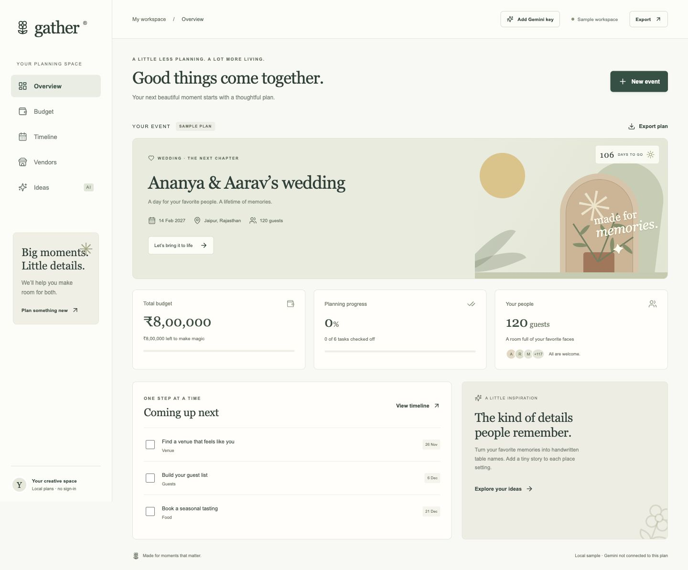
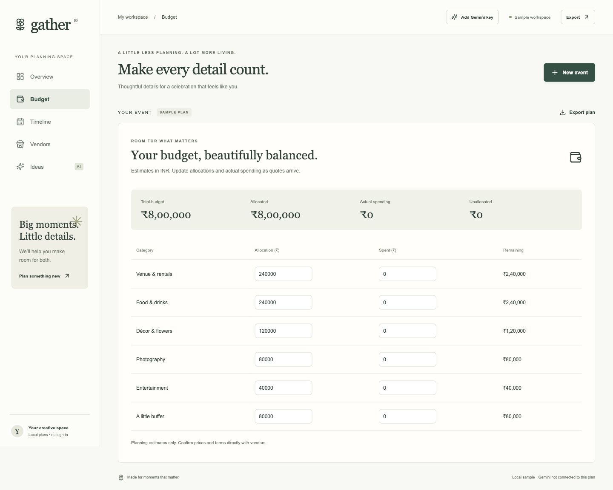
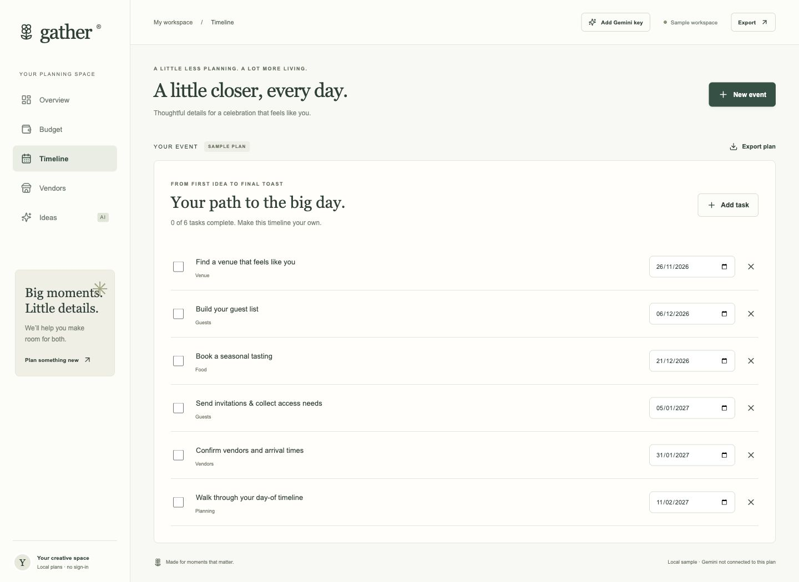
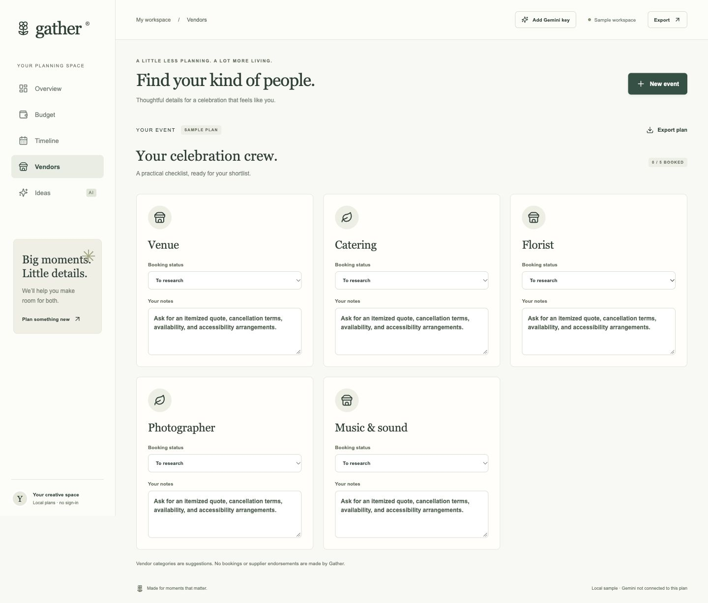
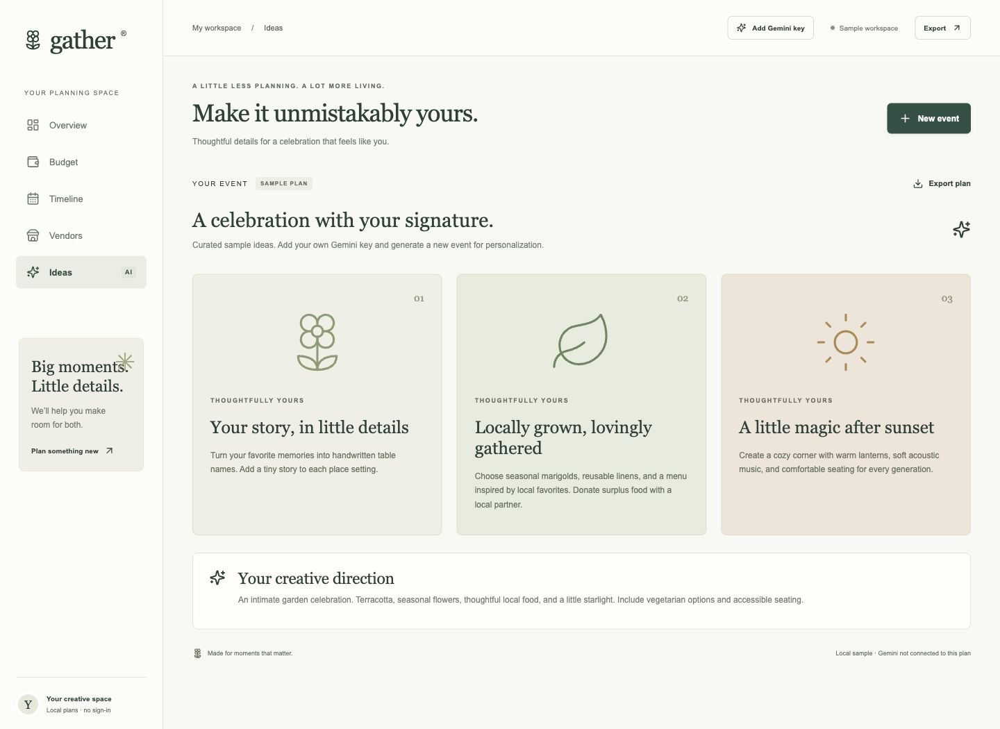
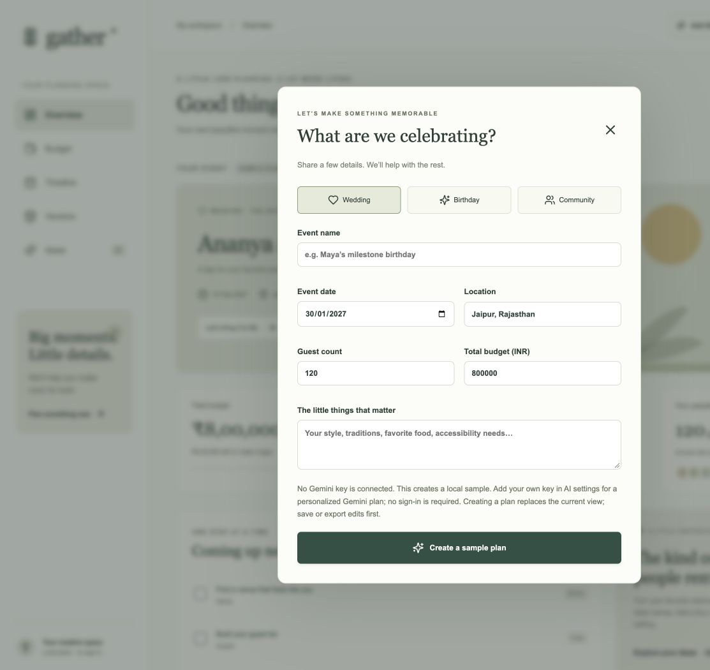
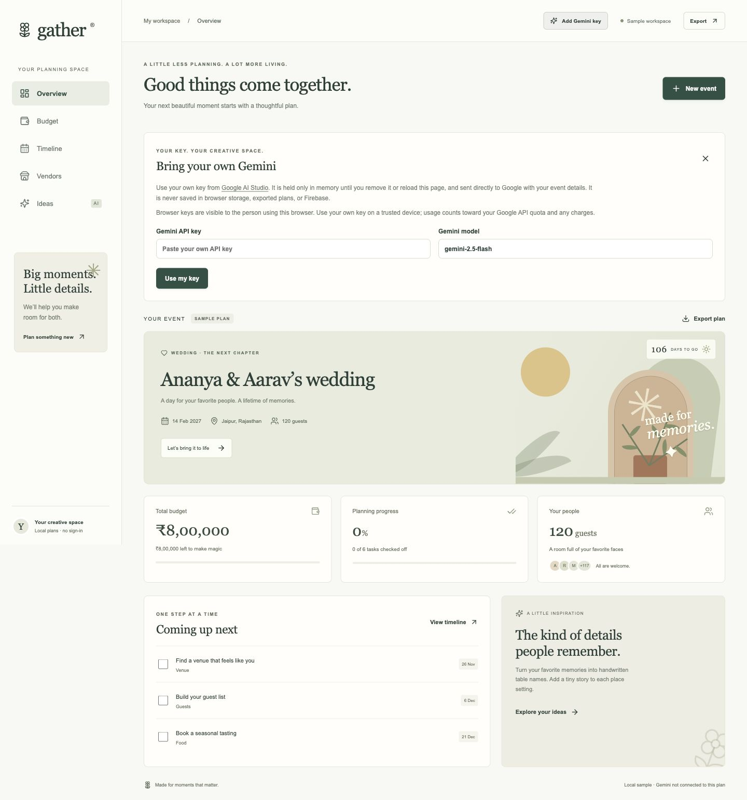
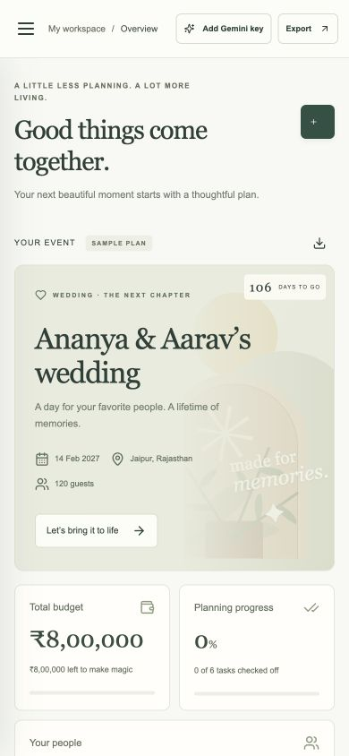
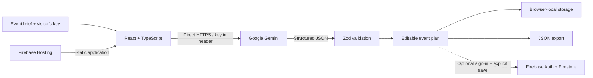

<div align="center">

# ✳ Gather

### Big moments. Little details.

A thoughtful GenAI planning assistant for weddings, birthdays, and community events.<br/>
From the first idea to the final toast — budgets, timelines, vendors, and personal touches, together.

[**Open the live app ↗**](https://gather-promptwars-2026-8f31.web.app) · [Try the demo](#try-it-in-two-minutes) · [Setup guide](docs/SETUP.md) · [Architecture](docs/ARCHITECTURE.md)

[](https://github.com/Navaneeth-007/gather/actions/workflows/check.yml)


[](LICENSE)



**Built for Google Hack2Skill PromptWars.** Independent hackathon entry; not an official Google product.

</div>

## The idea

A celebration begins with a feeling. Making it happen usually means scattered notes, uncertain costs, and a growing list of things to remember.

Gather turns a short event brief into a structured, editable plan. Share the occasion, date, location, guest count, budget, and what matters to you. Gemini proposes a practical starting point; you stay in control of every amount, task, and detail.

## What you can do

| Planning need | Gather's approach |
| --- | --- |
| **A plan that feels personal** | Gemini-generated ideas shaped by the event brief, preferences, dietary and accessibility needs. |
| **A budget you can work with** | INR allocations, actual spending, remaining amounts, and clear over-budget warnings. |
| **The next right step** | Editable task titles and dates, completion tracking, and a timeline sorted by due date. |
| **A dependable celebration crew** | Vendor categories, research notes, and research → shortlist → booked status. |
| **Your plans, your control** | Browser-local persistence and JSON export; optional account-based cloud saving. |
| **Access on any screen** | Responsive layouts, labeled controls, keyboard focus, native dialogs, and reduced-motion support. |

## Try it in two minutes

**No-key walkthrough:** [open Gather](https://gather-promptwars-2026-8f31.web.app), explore the sample wedding, change a budget amount, complete a task, and shortlist a vendor. The sample is clearly labeled and needs no account.

**Personalized Gemini plan:**

1. Select **Add Gemini key** and enter your own key from [Google AI Studio](https://aistudio.google.com/api-keys).
2. Choose **Use my key**, then **New event**. Add your occasion, budget, guests, location, and preferences.
3. Choose **Create my plan with Gemini**. Review and edit the returned plan, then export it.
4. Use **AI connected → Remove key** when finished. A page reload also forgets the key.

No Firebase sign-in or Blaze upgrade is required for this generation flow. Your key's Google API access, quotas and any charges still apply. A failed Gemini request keeps the existing plan intact.

> **Key handling:** the visitor's key stays in page memory and travels directly to Google in a request header. It is not saved to browser storage, Firebase, source files, or exported plans. Browser-supplied keys are visible to the person using that browser; use your own key on a trusted device. Never put a shared operator key in a frontend bundle.

## A closer look

Screenshots below show the included **sample event**, captured from the deployed app. They demonstrate the interface, not a claimed live Gemini response. No real key appears in any image.

<table>
<tr>
<td width="50%"><a href="docs/screenshots/budget.jpg"></a><br/><b>Make every detail count.</b> Allocate, track, and adjust.</td>
<td width="50%"><a href="docs/screenshots/timeline.jpg"></a><br/><b>A little closer, every day.</b> A clear path to the celebration.</td>
</tr>
<tr>
<td><a href="docs/screenshots/vendors.jpg"></a><br/><b>Find your kind of people.</b> Keep your shortlist organized.</td>
<td><a href="docs/screenshots/ideas.jpg"></a><br/><b>Make it unmistakably yours.</b> Thoughtful, personal details.</td>
</tr>
<tr>
<td><a href="docs/screenshots/new-event.jpg"></a><br/><b>Start with a few details.</b> One brief, one cohesive plan.</td>
<td><a href="docs/screenshots/gemini-settings.jpg"></a><br/><b>Your key. Your creative space.</b> No shared application key.</td>
</tr>
</table>

<details>
<summary><strong>See the mobile experience</strong></summary>
<br/>

</details>

## Built to be understandable



**React 19 · Vite · TypeScript · Zod · Gemini API · Firebase · Lucide**

Model output is parsed and validated before replacing a plan: malformed structures, duplicate IDs, over-budget allocations, and dates outside the planning window are rejected. Errors are readable and do not expose upstream payloads or credentials. The interface uses escaped React text, not generated HTML.

[Read the architecture and data flow →](docs/ARCHITECTURE.md)

## Run locally

Use **Node 22+** and npm.

```sh
git clone https://github.com/Navaneeth-007/gather.git
cd gather
npm ci
npm run dev
```

Open the URL printed by Vite. Local samples and visitor-key generation need no `.env` file. For the full validation suite, install the optional server dependencies too:

```sh
npm --prefix functions ci
npm run check
npm run check:repo
```

| Command | Purpose |
| --- | --- |
| `npm run dev` | Local development server |
| `npm test` | Schema, UI, Gemini-client privacy and failure tests |
| `npm run build` | Strict TypeScript checks and production frontend build |
| `npm run check` | Tests, frontend build, and optional Function build |
| `npm run check:repo` | Enforce the submission's 10 MB tracked-file limit |
| `npm run test:rules` | Firestore rules tests with Java 21+ and Firebase emulators |

[Configuration, optional cloud saving, and deployment →](docs/SETUP.md)

## Current delivery status

| Component | Status |
| --- | --- |
| Responsive interface and local planning | Live on Firebase Hosting |
| Visitor-key Gemini generation | Implemented; request/response and failure paths tested with mocks |
| Automated app and validation tests | 14 passing in the latest local run; CI runs on pushes and pull requests |
| Frontend and optional Function builds | Passing locally |
| Firestore database, owner rules, and indexes | Created and deployed |
| Google sign-in and cloud saving | Optional; requires Auth configuration and integration verification |
| Server-key Firebase Function | Alternative implementation retained; not used by the current UI or deployed |
| Firestore rules emulator suite | Included; needs Java 21+ and has not been verified locally |

A live Gemini request requires your own working key. The default model can be changed in AI settings if availability differs for your account. Vendor entries are categories to research, prices are estimates, and Gather does not book or pay suppliers.

## Submission and demo

Source, lockfiles, and compressed screenshots fit comfortably below the **10 MB repository limit**. Dependencies, builds, environment files, and emulator data are ignored. Run `npm run check:repo` before submitting.

For a recording, follow the [two-minute demo storyboard](docs/DEMO.md). Hide your API key during entry and never show it in screenshots or Git history. Submit this **public repository** and an accessible unlisted video link according to the event's instructions.

## Project map

```text
src/                    React interface, local sample, direct Gemini client
shared/                 Typed event contracts and validation
functions/              Optional server-key Firebase Function alternative
tests/                  UI, schema, Gemini-client and Firestore rule tests
docs/screenshots/       Screenshots of the live sample experience
docs/                   Setup, architecture, and demo storyboard
scripts/                Submission size check
.github/                CI, issue form, and pull-request template
firestore.rules         Owner-isolated event access
firebase.json           Hosting, security headers, and emulator configuration
```

[Contributing](CONTRIBUTING.md) · [Security](SECURITY.md) · [Verification details](VERIFICATION.md) · [MIT license](LICENSE)
