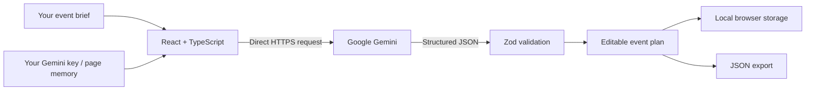

<div align="center">

# ✳ Gather

### Big moments. Little details.

A thoughtful GenAI planner for weddings, birthdays, and community events.<br/>
Budgets, timelines, vendors, and personal touches — together.

[**Open Gather ↗**](https://gather-promptwars-2026-8f31.web.app) · [Features](#features) · [Getting started](#getting-started)

[](https://github.com/Navaneeth-007/gather/actions/workflows/check.yml)


[](LICENSE)


</div>

## The idea

A celebration begins with a feeling. Making it happen usually means scattered notes, uncertain costs, and a growing list of things to remember.

Gather turns a short event brief into a structured, editable plan. Share the occasion, date, location, guest count, budget, and what matters to you. Gemini proposes a practical starting point; you stay in control of every amount, task, and detail.

## Features

| Planning need                | Gather's approach                                                                                         |
| ---------------------------- | --------------------------------------------------------------------------------------------------------- |
| **Personal ideas**           | Gemini-generated suggestions shaped by your preferences, dietary needs, and accessibility requirements.   |
| **Practical budgets**        | INR allocations, actual spending, remaining amounts, and over-budget warnings.                            |
| **A clear next step**        | Editable tasks, due dates, completion tracking, and a sorted timeline.                                    |
| **An organized shortlist**   | Vendor categories, notes, and research → shortlist → booked status.                                       |
| **Your plans, your control** | Automatic saving on your device and JSON export.                                                          |
| **Access on any screen**     | Responsive layouts, labeled controls, visible keyboard focus, native dialogs, and reduced-motion support. |

## Make it yours

1. Open [Gather](https://gather-promptwars-2026-8f31.web.app) and select **Add Gemini key**.
2. Enter your own key from [Google AI Studio](https://aistudio.google.com/api-keys), then choose **Use my key**.
3. Select **New event**, add your details, and choose **Create my plan with Gemini**.
4. Review and edit the plan. Track spending, complete tasks, and shortlist vendors.
5. Export a copy whenever you like. Use **AI connected → Remove key** to forget your key; reloading the page also clears it.

You can explore a labeled sample plan without a key. No account is required.

## A closer look

Screenshots use Gather's included sample event.

<table>
<tr>
<td width="50%"><a href="docs/screenshots/budget.jpg"></a><br/><b>Make every detail count.</b> Allocate, track, and adjust.</td>
<td width="50%"><a href="docs/screenshots/timeline.jpg"></a><br/><b>A little closer, every day.</b> A clear path to the celebration.</td>
</tr>
<tr>
<td><a href="docs/screenshots/vendors.jpg"></a><br/><b>Find your kind of people.</b> Keep your shortlist organized.</td>
<td><a href="docs/screenshots/ideas.jpg"></a><br/><b>Make it unmistakably yours.</b> Thoughtful, personal details.</td>
</tr>
<tr>
<td><a href="docs/screenshots/new-event.jpg"></a><br/><b>Start with a few details.</b> One brief, one cohesive plan.</td>
<td><a href="docs/screenshots/gemini-settings.jpg"></a><br/><b>Your key. Your creative space.</b> No shared application key.</td>
</tr>
</table>

<details>
<summary><strong>See the mobile experience</strong></summary>
<br/>

</details>

## How it works



**React 19 · Vite · TypeScript · Zod · Gemini API · Lucide · Firebase Hosting**

A shared schema validates event details, saved records, and generated plans. Budget totals, duplicate IDs, and task dates are checked before a result replaces your plan. Failed requests preserve the existing plan. Generated text is rendered through React, and the interface is built with compact CSS artwork and SVG icons.

### Your key and your data

The key stays in page memory and is sent directly to Google in a request header. It is not saved to browser storage, source files, or exported plans. Browser-entered keys are visible on that device; use your own key on a trusted browser. Google API access, quotas, and any charges belong to your key's project.

Plans are stored locally on your device. Avoid sensitive guest details and export a copy before clearing browser data. Vendor entries are research categories, and prices are planning estimates.

## Getting started

Use **Node 22+** and npm.

```sh
git clone https://github.com/Navaneeth-007/gather.git
cd gather
npm ci
npm run dev
```

Open the local URL printed by Vite. No environment file is needed; enter your Gemini key in the app when you want a personalized plan. You can change the model in AI settings if your key has access to a different Gemini model.

| Command           | Purpose                                 |
| ----------------- | --------------------------------------- |
| `npm run dev`     | Start local development                 |
| `npm test`        | Run the app and validation tests        |
| `npm run build`   | Type-check and build the production app |
| `npm run preview` | Preview the production build locally    |
| `npm run check`   | Run tests and the production build      |

## Hosting

Gather is a static application hosted on Firebase Hosting. To publish it to the project selected in `.firebaserc`:

```sh
npm run build
firebase deploy --only hosting
```

The deployment includes security headers and a content policy that allows API requests to the Gemini endpoint.

[Contributing](CONTRIBUTING.md) · [Security](SECURITY.md) · [MIT license](LICENSE)
